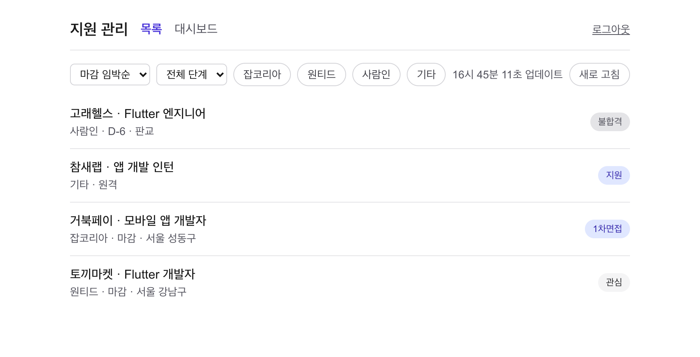
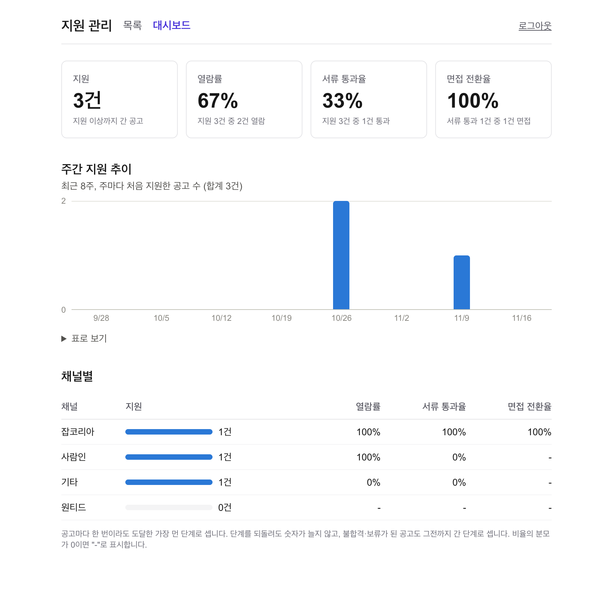

# job_tracker

채용 공고를 등록하고 지원 단계를 관리하는 서비스. Flutter 앱과 Next.js 웹이 같은 Supabase 계정과 DB를 쓴다.

- 웹: https://job-tracker-beta-umber.vercel.app — 내 실제 지원 기록이 들어 있는 개인용이라 새 가입을 막아 두었고, 열면 로그인 화면만 보인다. 대신 아래에 로컬 DB의 가짜 시드 데이터로 찍은 화면을 둔다.

| 공고 목록 | 대시보드 |
|---|---|
|  |  |

<sub>로컬 Supabase(`supabase db reset`)의 시드 계정 me@test.local로 로그인해 찍은 화면. 회사 이름은 지어낸 것이다.</sub>

> 진행 중 — 1단계(DB·RLS·로컬 Supabase), 2단계(Flutter 앱), 3단계(Next.js 웹 + Vercel 배포) 완료. 다음은 4단계(푸시 알림). 화면 캡처와 아키텍처 다이어그램은 단계가 진행되면서 채운다.

## 필요 환경
| 도구 | 버전 |
|---|---|
| Flutter | 3.47 (개발에 쓴 버전) |
| Node | 24 LTS (웹) |
| Supabase CLI | 3.x |
| Docker 실행기 | OrbStack / Docker Desktop / Colima 중 하나 |

## 로컬 실행
```bash
# 1. 로컬 Supabase (처음엔 이미지 다운로드로 몇 분 걸림)
supabase start
supabase db reset            # 마이그레이션 + 시드(테스트 계정 2개) 적용

# 2. DB 검증
supabase test db             # RLS·단계 이력 트리거 테스트(pgTAP)
./supabase/scripts/check_rls.sh   # 앱과 같은 경로(REST + 로그인)로 RLS 확인

# 관리 화면: http://127.0.0.1:54323 (Studio), 메일함: http://127.0.0.1:54324
# 시드 계정: me@test.local / other@test.local, 비밀번호 password123

# 3. Flutter 앱
cd apps/mobile
cp env/local.example.json env/local.json   # PUBLISHABLE_KEY 값은 `supabase status`에서
                                           # 안드로이드 에뮬레이터는 10.0.2.2, iOS 시뮬레이터는 127.0.0.1
flutter run --dart-define-from-file=env/local.json
flutter test                               # 로컬 Supabase가 켜져 있으면 저장소 통합 테스트도 돈다

# 4. 웹
cd apps/web
npm install
cp .env.example .env.local                 # PUBLISHABLE_KEY 값은 `supabase status`에서
npm run dev                                # http://localhost:3000
npm run lint && npm test                   # 목록 필터·통계 계산 테스트(vitest)
```

## 앱 화면
| 화면 | 하는 일 |
|---|---|
| 로그인 | 이메일·비밀번호 로그인/가입. 로그인 상태에 따라 라우터가 화면을 바꾼다 |
| 목록 | 지원·열람률·서류 통과율·면접 전환율 요약, 단계·채널 필터, 마감 임박/최근 변경/최근 등록 정렬, D-day |
| 상세 | 공고 정보, 단계 변경(지난 날짜로 기록 가능), 단계 이력, 수정·삭제 |
| 등록·수정 | 회사명·포지션(필수), URL, 채널, 마감일, 근무지, 고용형태, 메모 |

## 웹 화면
| 화면 | 하는 일 |
|---|---|
| 로그인 | 이메일·비밀번호 로그인. 로그인 안 한 요청은 서버(`proxy.ts`)가 화면을 만들기 전에 로그인으로 보낸다 |
| 목록 `/postings` | 앱 목록과 같은 단계·정렬 필터와 D-day. 브라우저에서 불러온다(TanStack Query) |
| 대시보드 `/stats` | 지원·열람률·서류 통과율·면접 전환율 타일, 주간 지원 추이 차트, 채널별 표. 서버에서 계산해 숫자가 채워진 화면을 보낸다 |

## 배포
| 대상 | 방식 |
|---|---|
| 웹 | Vercel. main에 push하면 자동 배포, 실행 지역은 DB와 같은 서울(`icn1`) |
| DB | Supabase 클라우드(서울). 스키마는 로컬에서 마이그레이션으로 확인한 뒤 `supabase db push --remote` |
| 접속 정보 | 웹은 Vercel 환경 변수, 앱은 `apps/mobile/env/prod.json`(커밋 안 함). 둘 다 공개용 키만 |

## DB 구조
| 테이블 | 내용 |
|---|---|
| `profiles` | 사용자 (가입 시 트리거로 생성) |
| `job_postings` | 공고 + 현재 지원 단계. 혼자 쓰는 서비스라 공고 1개 = 지원 1건 |
| `application_events` | 단계 변경 이력. `stage`가 바뀌면 트리거가 기록, 클라이언트는 읽기만 |
| `skills` | 내 보유 기술 (5단계 공고 분석 비교용) |

모든 테이블에 RLS: 본인 행만 읽고 쓴다. 정책은 `supabase/migrations/`에 있다.

## 기록
- [docs/AI_LOG.md](docs/AI_LOG.md) — AI가 틀렸거나 방향을 바꾼 지점
